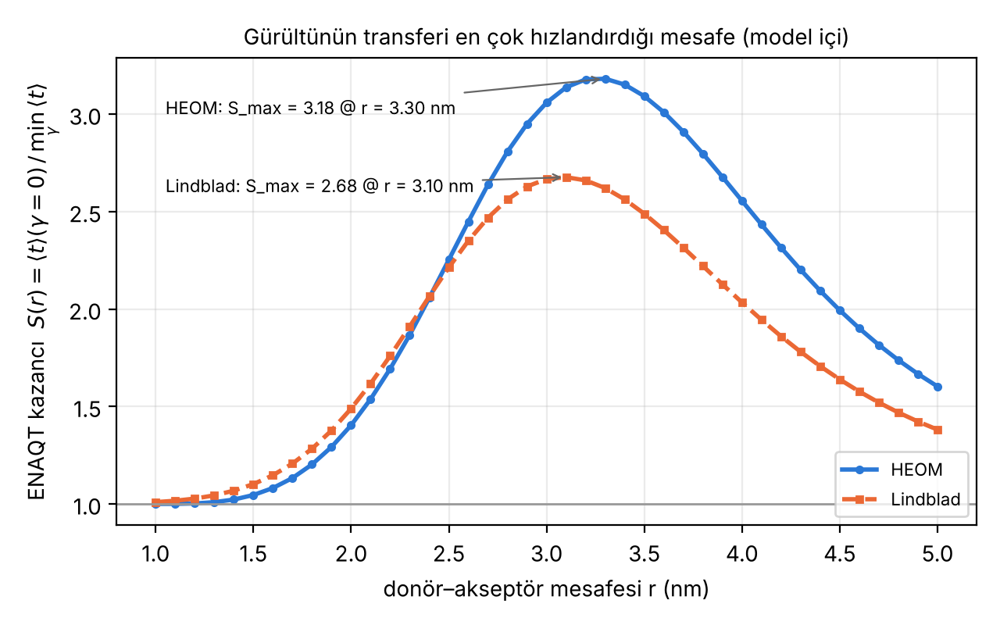
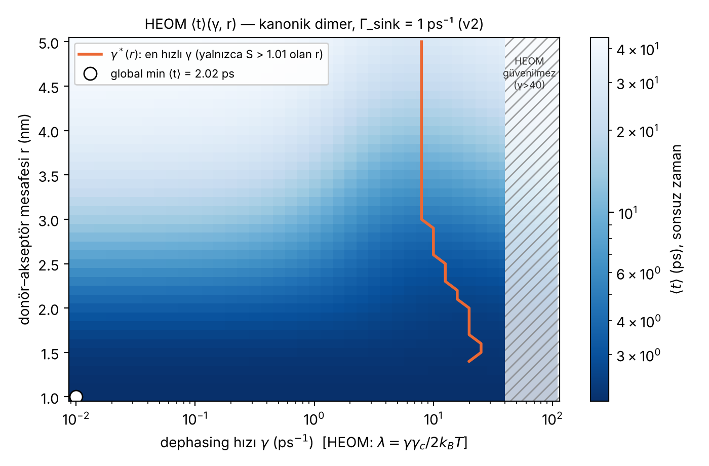
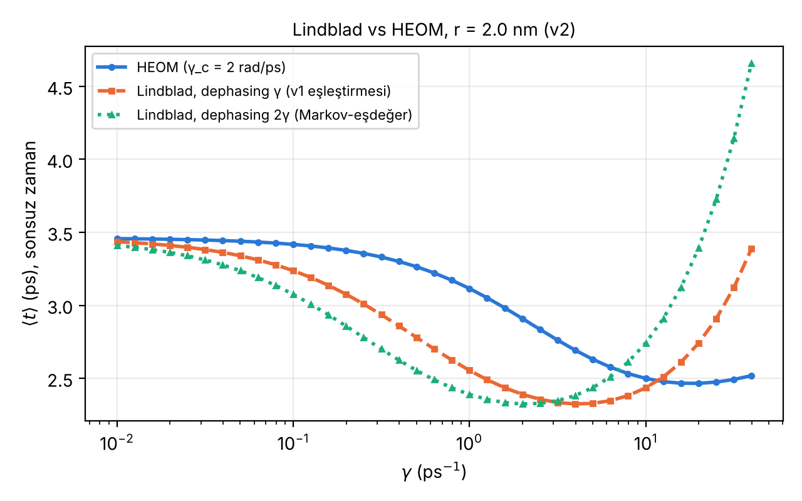
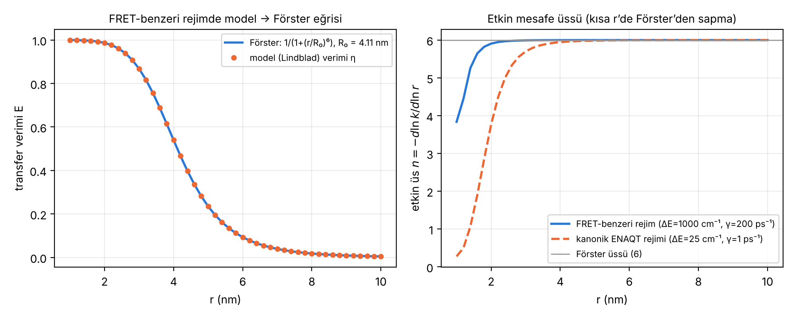

# Biyomoleküler İskeleli Kromofor Çiftlerinde Çevre-Yardımlı Enerji Transferi (ENAQT)

**Açık kuantum sistem simülasyonu ve kararlı-hal FRET ile sınır-rejim kontrolü**
Bağımsız lise araştırma projesi · in silico aşama + yapay zekâ / laboratuvar araçları · **revizyon v3**

> **Kısaca:** Bir donör–akseptör kromofor çiftinde, orta düzeyde çevresel gürültünün (dephasing) enerji transferini *model içinde* hızlandırıp hızlandırmadığını (ENAQT) Lindblad ve HEOM yöntemleriyle inceliyoruz. Laboratuvar aşamasında ölçülecek olan şey ise ENAQT değil, modelin **inkoherent (Förster) sınırıdır**: peptit/protein iskelede kararlı-hal FRET verimi E(r). ENAQT bu projede **deneysel olarak test edilmemektedir**.

v2 revizyonunda v1'deki bazı sayısal iddialar düzeltildi veya geri çekildi. v3'te simülasyonu laboratuvara bağlayan yapay zekâ / makine öğrenmesi araçları eklendi (§11 ve [docs/ML_YOL_HARITASI.md](docs/ML_YOL_HARITASI.md)). Ayrıntılar için [CHANGELOG.md](CHANGELOG.md) dosyasına bakın.

---

## İçindekiler

1. [Araştırma sorusu ve kapsam](#1-araştırma-sorusu-ve-kapsam)
2. [Klasör yapısı](#2-klasör-yapısı)
3. [Kurulum ve çalıştırma](#3-kurulum-ve-çalıştırma)
4. [Model](#4-model)
5. [Ana bulgular (v2)](#5-ana-bulgular-v2)
6. [Simülasyon–FRET köprüsü](#6-simülasyonfret-köprüsü)
7. [Deney planı](#7-deney-planı)
8. [Sınırlamalar](#8-sınırlamalar)
9. [Şekiller](#9-şekiller)
10. [Yapay zekâ kullanımı beyanı](#10-yapay-zekâ-kullanımı-beyanı)
11. [Yapay zekâ ve laboratuvar araçları (v3)](#11-yapay-zekâ-ve-laboratuvar-araçları-v3)
12. [Kaynaklar](#12-kaynaklar)

---

## 1. Araştırma sorusu ve kapsam

**Soru (model içi):** İki seviyeli bir donör–akseptör sisteminde, dephasing hızı γ'nın orta değerleri ortalama yakalanma süresini ⟨t⟩ hem tam koherent (γ → 0) hem de çok gürültülü durumlara göre kısaltıyor mu? Bu etki hangi mesafe r aralığında en belirgin? Banyo hafızası (HEOM) sonucu nasıl değiştiriyor?

**Bu proje ne iddia eder:**
- Seçilen *kanonik* model parametrelerinde ENAQT'nin sayısal imzası ve bunun r'ye bağımlılığı.
- Aynı modelin FRET-benzeri parametrelerde Förster yasasına (E = 1/(1+(r/R₀)⁶)) indiği.
- Laboratuvarda bu inkoherent sınırın kararlı-hal FRET ile kontrol edilebileceği.

**Bu proje ne iddia etmez:**
- Laboratuvarda ENAQT, kuantum koherans veya ps ölçekli dinamik ölçüldüğü.
- Kanonik modelin (ΔE = 25 cm⁻¹) gerçek bir boya çiftini temsil ettiği.
- Bir kuantum cihaz/çip tasarlandığı.

## 2. Klasör yapısı

```
├── README.md, SUMMARY.md, CHANGELOG.md, LICENSE, requirements.txt
├── run_all_v2.sh                       # v2 analiz zincirinin tamamı
├── run_all_ml.sh                       # v3 yapay zekâ + laboratuvar araçları zinciri
├── docs/ML_YOL_HARITASI.md             # v3 yol haritası, durum, raporlama dili
├── data/lab/                           # laboratuvar dosya şablonları + ornek/ (ÖRNEK ve SENTETİK)
├── src/
│   ├── enaqt_core.py                   # v2 çekirdek: numpy/scipy Lindblad + HEOM, sonsuz-zaman η ve ⟨t⟩
│   ├── analyze_legacy_csv.py           # v1 CSV'den doğrudan sayılar (global min, S(r))
│   ├── validate_against_legacy_csv.py  # v2 HEOM == v1 QuTiP mi? + kesme hatası
│   ├── validate_lindblad_v1.py         # v1 Lindblad haritasının kesme hatası
│   ├── heom_convergence.py             # hiyerarşi derinliği / Matsubara testi
│   ├── lindblad_heom_mapping_check.py  # γ ↔ λ eşleştirmesindeki ~2 çarpanı
│   ├── heom_2d_scan_v2.py              # ANA v2 TARAMA: log-γ, sonsuz zaman, S(r)
│   ├── lindblad_vs_heom_v2.py          # r = 2 nm Lindblad–HEOM karşılaştırmasının tekrarı
│   ├── sink_sensitivity.py             # Γ_sink = 0.5 / 1 / 2 ps⁻¹
│   ├── forster_limit.py                # FRET-benzeri rejimde Förster limiti
│   ├── ml_*.py                         # v3 (A) in silico: veri seti, emülatör, Δ-öğrenme, seyrek regresyon
│   ├── fret_*.py                       # v3 (B) laboratuvar: Bayesçi FRET modeli, kalibrasyon, ön-kayıt, karşılaştırma
│   └── (v1, QuTiP) quantum_biology_module.py, enaqt_parameter_scan.py,
│        heom_nonmarkovian_validation.py, heom_2d_robustness_scan.py
└── results/
    ├── figures/   # v1 ve v2 şekilleri (v2 adlarında "v2" ya da yeni ad)
    ├── data/      # v1 ham verileri (değiştirilmedi) + heom_2d_scan_v2.csv
    ├── tables/    # README'deki her sayının kaynağı olan küçük tablolar
    ├── ml/        # v3 (A) veri seti, emülatör, Δ-öğrenme, seyrek regresyon çıktıları
    └── fret/      # v3 (B) kalibrasyon testi, ÖRNEK ön-kayıt, SENTETİK karşılaştırma
```

v1 scriptlerinde yalnızca çıktı yolları göreli hale getirildi; fizik ve hesap değiştirilmedi.

## 3. Kurulum ve çalıştırma

```bash
pip install -r requirements.txt       # v2 için numpy, scipy, pandas, matplotlib yeterli
bash run_all_v2.sh                    # tüm v2 tablo ve şekilleri yeniden üretir (~20–40 dk)
bash run_all_ml.sh                    # v3 yapay zekâ + laboratuvar araçları (~45–60 dk; scikit-learn gerekir)
python src/heom_2d_scan_v2.py --reuse # yalnızca tablo/grafikleri yeniden çizer (saniyeler)
```

v1 scriptleri (`src/quantum_biology_module.py` vb.) QuTiP 5.3 ister.

**Neden v2'de QuTiP yerine kendi HEOM kodumuz var?** v2 hesapları QuTiP kurulamayan bir ortamda yapıldı. Bu yüzden aynı denklemler numpy/scipy ile yeniden yazıldı (`src/enaqt_core.py`). Bu uygulama v1'in QuTiP çıktısını 400 noktanın hepsinde yeniden üretiyor: en büyük fark η'da 7.0×10⁻⁵, ⟨t⟩'de göreli 1.1×10⁻⁴ (`results/tables/validation_summary.txt`). Ek avantajı, η ve ⟨t⟩'nin zaman kesmesi olmadan, sonsuz zamana kadar analitik hesaplanabilmesidir.

## 4. Model

| Bileşen | Tanım |
|---|---|
| Sistem | 2 site (D, A); H = [[E_D, V], [V, E_A]], V(r) = V₀(r₀/r)³ (nokta-dipol) |
| Kanonik parametreler | E_D − E_A = 25 cm⁻¹, V₀ = 20 cm⁻¹ @ r₀ = 2 nm, T = 298 K |
| Markov kanalları | D↔A gevşeme 0.02 ps⁻¹ (detailed balance), **sink** A → yakalama Γ_sink = 1 ps⁻¹, **loss** her siteden 0.001 ps⁻¹ |
| Lindblad dephasing | √γ \|n⟩⟨n\| (n = D, A) → D–A koheransı γ hızıyla söner |
| HEOM | Her sitede bağımsız Drude–Lorentz banyosu, γ_c = 2 rad/ps (τ_c = 0.5 ps), λ = γγ_c/(2k_BT), Nk = 1; v2'de derinlik **11** |
| Metrikler | η = Γ_sink∫P_A dt, ⟨t⟩ = Γ_sink∫t P_A dt / η, **sonsuz zamana kadar** (v2) |
| ENAQT kazancı | **S(r) = ⟨t⟩(γ = 0) / min_γ ⟨t⟩(γ, r)**; S = 1 ise gürültü hiç yardım etmiyor |

Sink ve loss "emici" durumlardır; bu yüzden v2'de 2×2 iz-azaltan bir yoğunluk matrisi kullanılır. Bu yaklaşım v1'in 4×4 modeliyle aynı P_A(t)'yi verir ve hareket denklemi matrisini tersinir yapar: ∫x dt = −M⁻¹x₀, ∫t x dt = M⁻²x₀.

## 5. Ana bulgular (v2)

Aşağıdaki her sayının kaynağı parantez içinde verilmiştir. Bütün değerler **kanonik oyuncak model** içindir.

### 5.1 "En hızlı nokta" ile "gürültünün en çok yardım ettiği nokta" farklıdır

| Ölçüt | Değer | Kaynak |
|---|---|---|
| Global min ⟨t⟩ (v2, sonsuz zaman) | **2.020 ps @ r = 1.00 nm, γ ≈ 0** (ızgara kenarı; η = 0.998) | `results/tables/scan_v2_headline.txt` |
| Aynı noktada ENAQT kazancı | **S = 1.000**: bu mesafede gürültü hiç yardım etmiyor | `results/tables/enaqt_gain_by_r_v2.csv`, r = 1.0 satırı |
| v1 CSV global min ⟨t⟩ | 2.0527 ps @ r = 1.000 nm, γ = 12.67 ps⁻¹ (v1'deki "r ≈ 1.4 nm" iddiasıyla çelişir) | `results/tables/legacy_csv_global_min.txt` (CSV'de başlıktan sonraki 4. satır) |
| En büyük ENAQT kazancı (HEOM) | **S_max = 3.18 @ r = 3.30 nm**, γ* = 7.9 ps⁻¹ (⟨t⟩: 20.6 → 6.5 ps) | `scan_v2_headline.txt` |
| S'nin yarı-yükseklik aralığı | **r = 2.5–4.4 nm** | `scan_v2_headline.txt` |
| r = 1.4 nm'de kazanç | S = 1.022 (yalnızca %2) | `enaqt_gain_by_r_v2.csv` |
| Lindblad karşılaştırma | S_max = 2.68 @ r = 3.10 nm | `scan_v2_headline.txt` |

Yorum: Kısa mesafede kaplin güçlüdür ve transfer zaten hızlıdır. ⟨t⟩'yi orada belirleyen şey sink'tir, gürültüye gerek yoktur. ENAQT kazancı, kaplinin enerji farkına göre zayıfladığı orta mesafelerde (≈2.5–4.4 nm) en büyüktür; ama oralarda transfer mutlak olarak daha yavaştır (⟨t⟩_min ≈ 3–19 ps). **v1'deki "r ≈ 1.4 nm, γ ∈ [10, 20] ps⁻¹ hedef pencere" iddiası geri çekilmiştir.**

### 5.2 "~2 ps" fiziksel bir tahmin değildir; Γ_sink seçimine bağlıdır

| Γ_sink (ps⁻¹) | 1/Γ_sink (ps) | Global min ⟨t⟩ (ps) | konumu | S_max | S_max'ın r'si |
|---|---|---|---|---|---|
| 0.5 | 2.0 | 3.988 | r = 1.0 nm | 3.58 | 3.2 nm |
| 1.0 | 1.0 | 2.020 | r = 1.0 nm | 3.16 | 3.2 nm |
| 2.0 | 0.5 | 1.011 | r = 1.0 nm | 2.33 | 3.4 nm |

Kaynak: `results/tables/sink_sensitivity.csv`. Bu duyarlılık testi daha seyrek bir ızgara kullanır (r 0.2 nm adımlı, γ ≤ 40 ps⁻¹). Bu yüzden Γ_sink = 1 satırındaki S_max (3.16 @ 3.2 nm), ana taramadaki 3.18 @ 3.30 nm değerinden biraz farklıdır.

**Sonuç:** En kısa ⟨t⟩ neredeyse tam olarak **2/Γ_sink**'tir. Kısa mesafede uyarılma D ve A arasında yaklaşık eşit paylaşılır ve sink yalnızca A'dan çalışır; bu yüzden etkin yakalama hızı ≈ Γ_sink/2'dir. ENAQT kazancının en büyük olduğu mesafe (r ≈ 3.2–3.4 nm) Γ_sink'e karşı sağlamdır; kazancın büyüklüğü (2.3–3.6) ise Γ_sink'e bağlıdır.

Model içinde ⟨t⟩, en az sink'e "bekleme" süresi 1/Γ_sink kadardır. Γ_sink = 1 ps⁻¹ bir model seçimidir, ölçülmüş bir değer değildir. Bu yüzden **"deneyde ~2 ps doğrulanacak" ifadesi kaldırılmıştır**. Kararlı-hal FRET zaten ps zaman ölçeğini ölçmez.

### 5.3 Lindblad ↔ HEOM karşılaştırması: ölçek farkı ve banyo hafızası

- **γ ↔ λ eşleştirmesinde ~2 çarpanı:** λ = γγ_c/(2k_BT) ile HEOM, D–A koheransını Lindblad'ın aynı γ değerine göre yaklaşık **2 kat hızlı** söndürür. Ölçülen oran 1.97–1.98, analitik değer 2γ (`results/tables/mapping_check.txt`). Yani v1'deki "aynı x-ekseni" karşılaştırması tam adil değildi.
- **r = 2 nm, sonsuz zaman, HEOM derinlik 11** (`results/tables/lindblad_vs_heom_v2.txt`):
  - HEOM: γ* = 20 ps⁻¹, ⟨t⟩_min = 2.465 ps
  - Lindblad (aynı γ): γ* = 3.98 ps⁻¹, ⟨t⟩_min = 2.324 ps
  - Lindblad (2γ, Markov-eşdeğer): HEOM ekseninde γ* = 2 ps⁻¹. Ölçek düzeltildikten sonra bile optimum ~10 kat kayıktır; bu kısım yavaş banyonun (hafıza) etkisidir.
  - γ = 39.8 ps⁻¹'de ⟨t⟩: HEOM 2.52 ps, Lindblad(2γ) 4.66 ps. Güvenilir aralıkta HEOM, güçlü gürültüye karşı daha az yavaşlıyor.
- **v1'deki "yüksek γ'da Zeno yükselişi banyo hafızasıyla belirgin biçimde yumuşar" iddiası bu kurulumla desteklenmiyor**, çünkü γ > 40 ps⁻¹'de HEOM sonuçları sayısal olarak güvenilmez (§5.4).

### 5.4 Sayısal güvenilirlik

- **Zaman kesmesi (v1):** v1'de η ve ⟨t⟩, T_MAX = 25 ps'de kesilen trapez integralinden hesaplanıyordu. r = 5 nm'de η 0.41–0.59 görünüyordu; aynı model (derinlik 5) sonsuz zamanda 0.96–0.97 veriyor. ⟨t⟩ ise 11–12 ps'de tavana takılıyordu; gerçek değer 27–44 ps (`results/tables/validation_summary.txt`, `truncation_error_by_r.csv`). v1 Lindblad haritası da r ≳ 2.1 nm'de aynı sorunu taşıyor (`validation_lindblad_v1.txt`). r = 1 nm'de ise 220 zaman adımı hızlı salınımları çözemediği için η'da ~0.009 hata vardı.
- **HEOM hiyerarşi derinliği:** v1'in derinlik 5 ayarı kısa mesafede yeterlidir (r = 1.4 nm'de ≤ %0.5), orta/büyük mesafede değildir. Derinlik 13'e göre ⟨t⟩ hatası γ ≤ 40 ps⁻¹'de %6.4'e, γ = 100 ps⁻¹'de %36'ya kadar çıkar. Derinlik 11, γ ≤ 40 ps⁻¹'de tüm test noktalarında derinlik 13'e göre %1'in altındadır (en kötü %0.87). Daha yüksek γ'da kesilmiş hiyerarşi kararsızlaşabilir: r = 4.5 nm, γ = 50 ps⁻¹'de derinlik 15, η = 2.12 gibi fiziksel olmayan bir değer veriyor. v2 taramasında da γ = 100 ps⁻¹'de η > 1 noktası çıktı. Bu yüzden HEOM sonuçları yalnızca **γ ≤ 40 ps⁻¹** için raporlanır (`results/tables/heom_convergence_summary.txt`, `scan_v2_headline.txt`).
- **Matsubara terimi:** Nk = 3'e göre ⟨t⟩ farkı Nk = 0'da ≤ %0.19, Nk = 1'de ≤ %0.05. Nk = 1 yeterlidir.
- **v1'deki "<%0.2 yakınsama" iddiası geri çekilmiştir:** yalnızca kısa mesafede doğrudur ve bunu destekleyen script/tablo yoktu.

## 6. Simülasyon–FRET köprüsü

**Absolute (kararlı-hal) FRET ne ölçer?** Donörden akseptöre aktarılan uyarılma kesrini, yani transfer verimi **E**'yi. E, donör sönümleme (E = 1 − F_DA/F_D) veya düzeltilmiş duyarlılaştırılmış akseptör emisyonu ile bulunur. Zaman çözünürlüğü (TCSPC) gerekmez.

**Ne ölçmez?** ps dinamiğini, koherans salınımlarını veya ENAQT'yi. FRET boyaları/proteinleri büyük enerji farkı, zayıf kaplin ve çok güçlü dephasing rejimindedir. Bu rejim kanonik ENAQT modelinden çok uzaktır.

**Köprü (`src/forster_limit.py`, `results/tables/forster_limit_summary.txt`):** Aynı Lindblad modeli, açıklayıcı FRET-benzeri parametrelerle (ΔE = 1000 cm⁻¹, γ = 200 ps⁻¹, V₀ = 20 cm⁻¹ @ 2 nm, k_D = 0.001 ps⁻¹, akseptörde hızlı yakalama) çalıştırıldı:
- r = 2–10 nm'de log k – log r eğimi **−5.996** (Förster: −6).
- R₀ (k_T = k_D) = **4.11 nm**. Model verimi ile 1/(1+(r/R₀)⁶) arasındaki en büyük fark **0.0005**.
- Transfer hızı Haken–Strobl formülü k = 2V²Γ/(Γ² + ΔE²) ile %1.5 içinde uyumlu.
- Karşılaştırma: kanonik ENAQT rejiminde etkin mesafe üssü r = 1 nm'de 0.28, 2 nm'de 3.76, 3 nm'de 5.70. Kısa mesafede Förster yasası geçerli değildir.

Bu parametreler belirli bir boya/protein çiftinin ölçülmüş değerleri **değildir**; amaç modelin doğru sınıra indiğini göstermektir. Gerçek çift için R₀ spektral örtüşme, donör kuantum verimi, kırılma indisi ve κ² ile ayrıca hesaplanmalıdır.

**Dürüst çerçeve:** Deney, modelin **inkoherent sınırını** doğrular ("model, ölçülen FRET verimini yeniden üretiyor mu?"). ENAQT penceresi deneyle test edilmemiş bir **model tahmini** olarak raporlanır.

## 7. Deney planı

Plan: ODTÜ'de peptit/protein iskelesiyle **kararlı-hal (absolute) FRET**. DNA iskelesi, Cy3/Cy5 boyaları ve TCSPC **zorunlu değildir**.

1. **Yapılar** (laboratuvarın olanaklarına göre biri):
   - Farklı uzunlukta rijit bağlayıcılı (ör. poliprolin) donör–akseptör peptitleri. Poliprolinin esnekliği ve mesafe dağılımı bir sınırlamadır.
   - Kısa ve uzun bağlayıcılı floresan protein füzyonları.
   - En basit sürüm: **donör-yalnız kontrol + D–A yapısı** (tek mesafe).
2. **Kontroller:** donör-yalnız, akseptör-yalnız (doğrudan uyarılma/sızma düzeltmesi), tampon boşluğu, konsantrasyon eşleme (absorbans).
3. **Ölçüm:** Kararlı-hal floresans spektrumları; E = 1 − F_DA/F_D ve/veya düzeltilmiş duyarlılaştırılmış emisyon. Her yapı için en az 3 bağımsız tekrar ve hata çubukları.
4. **Tahmin (ölçümden ÖNCE yazılıp kaydedilecek):** Her yapı için yapısal tahminden r ± belirsizlik, literatür/ölçümden R₀ (κ² = 2/3 varsayımıyla) ve E_tahmin = 1/(1+(r/R₀)⁶).
5. **Başarı ölçütü (önceden):** Ölçülen E, tahmin edilen E ile belirsizlikler içinde (ör. |ΔE| ≤ 0.1) uyumlu olmalı ve kısa/uzun bağlayıcı sıralaması doğru çıkmalı.
6. **Kaçınılacak iddialar:** "Viskozite/sıcaklıkla γ'yı ayarladık" (elektronik dephasing fs ölçeğindedir; viskozite daha çok boya dönmesini ve κ²'yi etkiler), "ENAQT/koherans ölçtük", "~2 ps'yi doğruladık".

## 8. Sınırlamalar

- Kanonik model (ΔE = 25 cm⁻¹) bir **oyuncak modeldir**; gerçek bir kromofor çiftinin parametreleri değildir.
- V ∝ 1/r³ nokta-dipol yaklaşımı ~2 nm'nin altında güvenilmezdir (kromoforlar bu boyuttadır). κ² yönelim faktörü modelde yoktur.
- Γ_sink, Γ_loss ve gevşeme hızları seçilmiş değerlerdir; ⟨t⟩'nin mutlak değeri bunlara bağlıdır (§5.2).
- HEOM sonuçları yalnızca γ ≤ 40 ps⁻¹ için güvenilirdir (§5.4). Bu kurulumla Zeno rejimi hakkında güvenilir HEOM sonucu yoktur.
- Lindblad/Haken–Strobl dephasing sonsuz sıcaklık sınırıdır; FRET köprüsünde detailed balance yoktur.
- v2 HEOM uygulaması QuTiP ile yalnızca derinlik 5'te karşılaştırıldı. Daha derin hiyerarşiler aynı denklemlerin doğrudan genişlemesidir ama ayrıca QuTiP ile karşılaştırılmadı.
- Hangi modelin (Förster / Redfield / Lindblad / HEOM) gerçek yapıyı en iyi anlattığı deneysel bir sorudur; planlanan FRET deneyi yalnızca Förster sınırını test eder.

## 9. Şekiller

### v2 (güncel)

**ENAQT kazancı S(r).** Gürültünün transferi en çok hızlandırdığı mesafe; HEOM ve Lindblad karşılaştırmalı.


**HEOM ⟨t⟩(γ, r), sonsuz zaman, log-γ.** Turuncu çizgi γ*(r); taralı bölge (γ > 40 ps⁻¹) HEOM'un güvenilmez olduğu yer.


**Lindblad vs HEOM, r = 2 nm (v2).** Aynı-γ ve 2γ (Markov-eşdeğer) Lindblad eğrileri.


**Förster limiti.** FRET-benzeri parametrelerde model → 1/(1+(r/R₀)⁶); sağda etkin mesafe üssü.


### v1 (arşiv; bilinen sorunlarla birlikte)

| Şekil | Durum |
|---|---|
| `dynamics_2site.png`, `dynamics_3site.png` | Temel Lindblad dinamiği; sorun bilinmiyor. |
| `single_point_sink_loss_dynamics.png` | Tek nokta dinamiği; sorun bilinmiyor. |
| `enaqt_1d_regime_slice.png` | Niteliksel olarak geçerli (Lindblad, kısa r). |
| `enaqt_dual_heatmap.png` | r ≳ 2.1 nm'de T_MAX kesmesinden etkilenir (`validation_lindblad_v1.txt`). |
| `lindblad_vs_heom_comparison.png` | HEOM derinlik 5, aynı-γ ekseni (2 çarpanı) ve γ > 40'ta güvenilmez HEOM noktaları içerir; yerine `lindblad_vs_heom_v2.png`. |
| `heom_robustness_heatmap.png`, `heom_mean_trapping_time_heatmap.png` | T_MAX kesmesi (r ≳ 2 nm) ve derinlik 5; yerine `heom_v2_mean_time_heatmap.png`. |

## 10. Yapay zekâ kullanımı beyanı

Bu depodaki kodun ve dokümantasyonun hazırlanmasında yapay zekâ asistanlarından yararlanılmıştır. Bu kullanım kod yazımı, hata ayıklama ve metin düzenlemesini kapsar. v2 revizyonu (yeni analiz scriptleri, yeniden hesaplamalar, bu README, SUMMARY ve CHANGELOG) ve v3 yapay zekâ / laboratuvar araçları (`src/ml_*.py`, `src/fret_*.py`, `docs/ML_YOL_HARITASI.md`) bir yapay zekâ asistanıyla (Anthropic Claude) birlikte hazırlanmıştır.

**Öğrencinin katkısı:** *[Öğrenci tarafından kendi cümleleriyle doldurulacak: ör. araştırma sorusunun seçimi, model ve parametre kararları, sonuçların yorumu, deney tasarımı, laboratuvar bağlantısı.]*

Hedef, kodun her adımını (ör. HEOM'un ne olduğu, λ–γ eşleştirmesi, neden sonsuz-zaman integrali kullanıldığı, Bayesçi modelin varsayımları) öğrencinin kendisinin açıklayabilmesidir.

## 11. Yapay zekâ ve laboratuvar araçları (v3)

Ayrıntılı plan, durum ve tüm tablolar: **[docs/ML_YOL_HARITASI.md](docs/ML_YOL_HARITASI.md)**.

Proje iki ayrı yola bölünmüştür.

- **(A) In silico yol.** Simülasyonu hızlandıran ve belirsizliğini veren emülatörler kuruldu.
- **(B) Laboratuvar yolu.** Kararlı-hal FRET verimini ölçümden **önce** belirsizlikle tahmin eden fizik-temelli bir Bayesçi model kuruldu.

PINN ana model olarak kullanılmadı. Denklemler biliniyor ve kesin çözülebiliyor; sistem katı; laboratuvar verisi zaman serisi değil, tek bir sayı (E).

**Öne çıkan sonuçlar (kaynaklar `results/ml/` ve `results/fret/` altında):**
- **HEOM emülatörü:** HEOM-GP (800 eğitim noktası) test kümesinde ⟨t⟩'yi medyan %0,14 hatayla, doğrudan HEOM'dan ~15 000 kat hızlı tahmin ediyor. Kanonik S(r) eğrisini yeniden üretiyor: S_max 3,23 ve 3,18, ikisi de r = 3,30 nm'de.
- **Emülatörün zayıf noktası:** Rastgele örneklemeyle, ENAQT açısından en ilginç koherent köşede (ΔE < 50 cm⁻¹, γ < 1 ps⁻¹) hata %41'e (%95'lik) çıkıyor ve belirsizlik aşırı özgüvenli (%90 aralık kapsaması %32). Bütçenin bir kısmını bu köşeye yönlendirmek sorunu gideriyor (%1,0, kapsama %94).
- **Δ-öğrenme (negatif sonuç):** Lindblad → HEOM Δ-öğrenme, HEOM'u doğrudan öğrenmekten iyi değil. "~2 çarpanı" transfer süresi için sabit bir düzeltme değil: oran 0,28–1,51 arasında değişiyor.
- **Seyrek regresyon:** Zayıf kaplin rejiminde veriden tek terimli r⁻⁶ yasasını buluyor (%0,1 hata). Bu bir doğrulama testi, keşif değil. Kanonik rejimde r = 1–8 nm için basit bir kuvvet yasası yok.
- **Bayesçi FRET modeli:** Sahte deneylerde (120 adet) R0, δ ve d0 için %90 aralıklar gerçek değeri %87,5–%92,5 oranında kapsıyor, yani belirsizlik dürüst. Ölçüm gürültüsü σ ise küçükken fazla tahmin ediliyor (kapsama %80); σ ayrıca tekrar ölçümlerinden belirlenmeli. Uydurmaya katılmayan bir yapının ortalama E'si medyan 0,011 hatayla ve %95 kapsamayla tahmin edildi (`results/fret/calibration/calibration_summary.txt`).
- **Uçtan uca demo (ÖRNEK yapılar, SENTETİK ölçümler):** Modelde olmayan bir etki (cis-kıvrım) bilerek eklendi. Ön-kayıtlı kural yine de geçti ve küresel δ etkiyi yakalamadı; R0 literatürden +2 sd kaydı. Sorunu bir-yapıyı-dışarıda-bırak testi yakaladı (2/4 kapsama). Karşılaştırma raporu bu tür kaymalar için artık otomatik uyarı veriyor.

**Laboratuvar iş akışı:**
1. `data/lab/` şablonlarını doldurun.
2. `src/fret_prereg.py` ile ön-kayıt yapın, commit'leyin ve etiketleyin.
3. Ölçün.
4. `src/fret_compare.py` ile karşılaştırın.

Adımlar ayrıntılı olarak `docs/ML_YOL_HARITASI.md` §5'te. `data/lab/ornek/` içindeki dosyalar ÖRNEK ve SENTETİK'tir, **gerçek ölçüm değildir**.

## 12. Kaynaklar

- Förster, T. (1948). *Ann. Phys.* 437, 55–75.
- Haken, H. & Strobl, G. (1973). *Z. Phys.* 262, 135–148.
- Stryer, L. & Haugland, R. P. (1967). *PNAS* 58, 719–726.
- Schuler, B. et al. (2005). *PNAS* 102, 2754–2759.
- Plenio, M. B. & Huelga, S. F. (2008). *New J. Phys.* 10, 113019.
- Rebentrost, P. et al. (2009). *New J. Phys.* 11, 033003.
- Ishizaki, A. & Fleming, G. R. (2009). *J. Chem. Phys.* 130, 234111.
- Tanimura, Y. (2020). *J. Chem. Phys.* 153, 020901.
- Lambert, N. et al. (2023). *Phys. Rev. Research* 5, 013181 (QuTiP-BoFiN / HEOM).

v3 (yapay zekâ / laboratuvar) için:
- Häse, F., Kreisbeck, C. & Aspuru-Guzik, A. (2017). *Chem. Sci.* 8, 8419 (HEOM transfer süresi için sinir ağı emülatörü).
- Goodman, J. & Weare, J. (2010). *Commun. Appl. Math. Comput. Sci.* 5, 65 (afin-değişmez topluluk örnekleyicisi).
- Talts, S. et al. (2018). arXiv:1804.06788 (simülasyon-tabanlı kalibrasyon, SBC).
- Kennedy, M. C. & O'Hagan, A. (2001). *J. R. Stat. Soc. B* 63, 425 (model uyuşmazlığıyla Bayesçi kalibrasyon).
- Brynjarsdóttir, J. & O'Hagan, A. (2014). *Inverse Problems* 30, 114007 (uyuşmazlık terimi ve tanımlanabilirlik).
- Perdikaris, P. et al. (2017). *Proc. R. Soc. A* 473, 20160751 (çok-doğruluklu GP).
- Brunton, S. L., Proctor, J. L. & Kutz, J. N. (2016). *PNAS* 113, 3932 (SINDy).
- Krishnapriyan, A. et al. (2021). *NeurIPS* 34 (PINN başarısızlık modları).
- Best, R. B. et al. (2007). *PNAS* 104, 18964 (poliprolin: cis-kıvrımlar ve boya esnekliği).
- Evers, T. H. et al. (2006). *Biochemistry* 45, 13183 (esnek bağlayıcılı floresan protein FRET'i, WLC modeli).
- Hellenkamp, B. et al. (2018). *Nat. Methods* 15, 669 (çok laboratuvarlı smFRET; R0/κ² belirsizliği).

Lisans: MIT (bkz. `LICENSE`).
